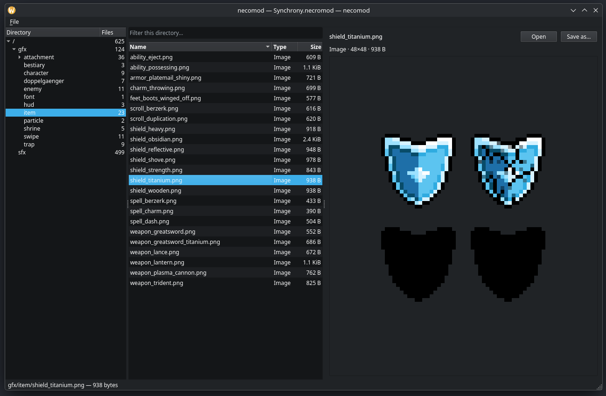

# necromod-browser

Tools for the Crypt of the NecroDancer resource package format
(`WSP1`, used by `.wsp` and `.necromod` files):

The format itself is documented in [SPEC.md](SPEC.md).

## Setup

```sh
uv sync                # installs the project + the `necromod`/`necromod-gui` scripts
uv sync --group zstd   # optional: read/write Zstandard packages
```

## GUI

```sh
uv run main.py                                  # or: uv run necromod-gui
uv run main.py NecroDancer64/dlc/Amplified.necromod
```



Images are previewed (with integer zoom for pixel art), text and source are shown
monospaced. Audio, LuaJIT bytecode, compiled models and other binary data show a
placeholder instead; use Open/Save to work with them. `File → Extract all…`
unpacks the whole archive.

## CLI

```sh
uv run necromod info  NecroDancer64/dlc/Amplified.necromod
uv run necromod ls -l NecroDancer64/NecroDancer.wsp
uv run necromod cat   NecroDancer64/NecroDancer.wsp data/necrodancer.xml
uv run necromod x     NecroDancer64/dlc/Synchrony.necromod -o /tmp/synchrony
uv run necromod pack  /tmp/synchrony -o Synchrony.necromod
uv run necromod verify --rebuild NecroDancer64/NecroDancer.wsp
```

### Commands

| Command                 | Description    |
| ----------------------- | -------------- |
| `info PKG`              | header summary |
| `ls PKG`                | list entries |
| `cat PKG NAME`          | write one entry to stdout (binary safe) |
| `extract PKG [NAME...]` | extract files |
| `pack DIR -o OUT`       | build a package |
| `verify PKG`            | decode every entry, check record contiguity, optionally re-serialise and compare |

`extract` defaults to a directory named after the package (`Amplified.necromod`
→ `Amplified/`). Existing files are skipped unless `-F/--force` is given.

Note: `uv run necromod COMMAND --help` will list all optional arguments

### Notes

* `pack` compresses files of at least 100 bytes with zlib level 8, matching the
  game's own compiler. Extracting a shipped archive and packing it again
  reproduces the original file **byte for byte**.
* `--no-compress` stores everything, which is handy when diffing.
* Packages whose header sets the `useZstd` flag are read/written only with
  `--group zstd` installed; no shipped NecroDancer package uses it.

## Library use

```python
from necromod import read_package, build_package, Entry

pkg = read_package("NecroDancer64/dlc/Amplified.necromod")
for entry in pkg.entries:
    print(entry.name, len(entry.data), "deflate" if entry.compressed else "stored")

blob = build_package([Entry("mod.json", b"{}")])
```

## License

MIT License. See [LICENSE](LICENSE).

Copyright (c) 2026 Matthew.

## AI Disclaimer

This software was developed with the assistance of LLMs.
